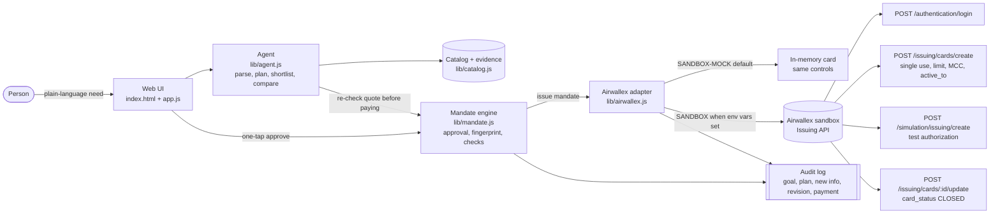
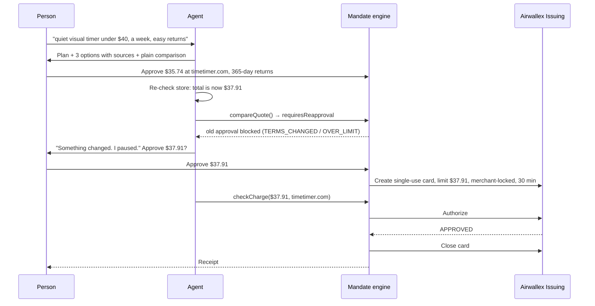

# AccessOS

**Shopping help for people with ADHD and other invisible disabilities. It finds the item, explains it in plain words, and can only pay what you approved.**

Built for the Airwallex Agentic Banking Hackathon (HackerEarth), **Kit 2: Intent-Bound Purchase Agent** using Airwallex Issuing virtual-card controls.

- Live demo: `{{DEMO_URL}}`
- Video walkthrough: `{{VIDEO_URL}}`

---

## The problem

Online shopping is a long chain of small decisions: compare tabs, decode return policies, check delivery dates, type card numbers, notice when the price changes at checkout. For people with ADHD, narcolepsy, chronic fatigue, autism or brain fog, each step is a chance to lose focus, overpay, impulse-buy or miss a return window.

AI agents could take that load off, but handing an agent your card is a bad deal. An agent that can pay "whatever looks right" is exactly the risk this group can least afford.

## What AccessOS does

1. **Need**: you type what you need in your own words ("a quiet visual timer under $40, here in a week, easy returns").
2. **Plan**: the agent states its goal and plan before doing anything.
3. **Shortlist with evidence**: up to 3 options. Every fact links to the page it came from, and the agent says what it *doesn't* know ("the listing does not say if it ticks").
4. **Plain-language comparison**: best fit, cheapest, fastest, easiest to return. Short sentences, no jargon.
5. **One-tap approval card**: exact item, store, total, return terms and delivery date.
6. **New info → revised decision**: right before paying, the agent re-checks the store. If the price, store or terms changed, the old approval *cannot* pay. The agent pauses, explains what changed, gives its revised recommendation and asks again.
7. **Mandate issued**: an Airwallex single-use virtual card, limited to the approved amount and locked to the approved merchant, expiring in 30 minutes.
8. **Payment result + receipt**: payment is authorized, the result is reported back, the card is closed, and a receipt is shown.

An **audit log** on screen records every step: GOAL → PLAN → ACTION → DECISION → APPROVAL → NEW INFO → BLOCKED → REVISION → MANDATE → PAYMENT → RESULT.

### Built for low cognitive load

- One decision per screen, with a step counter ("Step 5 of 8").
- Large type (20px base), high contrast, light and dark themes.
- Works with a keyboard only; focus moves to each new screen's heading; visible focus ring.
- Respects `prefers-reduced-motion`.
- **"Too much? Simplify"** hides evidence details, tables, the agent log and extra options. The choice is remembered.
- Checked with axe-core (WCAG 2.1 AA + best practice): no violations on any screen, light and dark, at a 390px mobile width.

## How the money logic works

All money rules live in code in [`lib/mandate.js`](lib/mandate.js), not in a prompt. The agent can only spend through a mandate.

| Rule | What happens |
|---|---|
| Amount above the approved total (even 1¢) | `OVER_LIMIT`, blocked |
| Any store other than the approved one | `WRONG_MERCHANT`, blocked |
| Different currency | `WRONG_CURRENCY`, blocked |
| Price up, shorter return window, new restocking fee, later delivery, different item | `compareQuote()` → `requiresReapproval: true`; the old mandate returns `TERMS_CHANGED` |
| Price goes down | Reported to you, no re-approval needed |
| Second use / expired / revoked | `ALREADY_USED` / `EXPIRED` / `NOT_ACTIVE` |

- Money is integer cents everywhere.
- An approval is bound to a **terms fingerprint**: a canonical hash of item, merchant, currency, total, return days, restocking fee, return method and delivery date.
- **Defense in depth**: AccessOS checks every charge *before* it reaches the card network (a blocked charge never calls Airwallex), **and** the Airwallex card carries the same limits (`SINGLE` use, `PER_TRANSACTION` limit, allowed currency, allowed MCC, `active_to`).

## Architecture





## Files

```
index.html, styles.css, app.js   static web demo (no build step)
lib/mandate.js                   money logic: approvals, fingerprints, mandates, charge checks
lib/agent.js                     need parsing, plan, shortlist, plain-language comparison, audit log
lib/catalog.js                   bundled catalog: real products, source + evidence URLs
lib/airwallex.js                 Airwallex Issuing adapter (SANDBOX-MOCK + SANDBOX)
scripts/run-demo.js              the full story in the terminal (mock or live sandbox)
scripts/e2e_check.py             optional headless browser check (Playwright)
test/*.test.js                   unit tests (node:test, no dependencies)
```

The same `lib/` files run in the browser and in Node (UMD pattern), so the demo UI and the tested backend use identical money logic.

## Setup

Requirements: any modern browser. For tests and the CLI, **Node 18+**. No `npm install` needed; there are no dependencies.

```bash
git clone {{REPO_URL}} accessos && cd accessos

# 1. Web demo: just open the file
open index.html            # or double-click it
# or serve it:
npm run serve              # http://localhost:8080

# 2. Unit tests
npm test

# 3. Full story in the terminal (SANDBOX-MOCK)
npm run demo
```

**GitHub Pages:** push the folder as-is and enable Pages on the branch root. `.nojekyll` is included. All paths are relative.

Optional browser check: `pip install playwright && python -m playwright install chromium && python3 scripts/e2e_check.py`

## Mock vs. sandbox mode

| | SANDBOX-MOCK (default) | SANDBOX (live Airwallex test environment) |
|---|---|---|
| Turn on | nothing to do | set `AIRWALLEX_CLIENT_ID` and `AIRWALLEX_API_KEY` |
| Where | browser demo + CLI + tests | CLI (`npm run demo`) only; keys never go in the browser |
| Card | in-memory card that enforces the same controls Airwallex would | real Airwallex virtual card |
| Authorization | simulated | `POST /api/v1/simulation/issuing/create` (sandbox only) |
| Money | none | sandbox test funds |

Environment variables for SANDBOX mode:

```bash
export AIRWALLEX_CLIENT_ID=...          # from Airwallex sandbox > Developer > API keys
export AIRWALLEX_API_KEY=...
export AIRWALLEX_CARDHOLDER_ID=...      # an existing sandbox cardholder (required to create cards)
export AIRWALLEX_CREATED_BY="Your Name" # full legal name, required by Create a Card
# optional
export AIRWALLEX_BASE_URL=https://api.sandbox.airwallex.com   # default; non-sandbox hosts are refused
export AIRWALLEX_USE_MERCHANT_BRANDS=1  # look up a merchant brand and add allowed_merchant_brands
export ACCESSOS_MODE=mock               # force mock even when keys are set
npm run demo
```

The adapter interface is the same in both modes:

```js
createMandateCard(mandate)       // -> { cardId, maskedPan, status, controls, request }
authorize(card, mandate, charge) // -> { approved, reason, plain, network, transactionId }
reportResult(card, result)       // -> { cardId, cardStatus, receipt }
```

Call shapes follow the public Airwallex API reference (version `2026-08-21`): [Obtain access token](https://www.airwallex.com/docs/api/authentication/api_access_token/login.md), [Create a card](https://www.airwallex.com/docs/api/issuing/cards/create.md), [Update a card](https://www.airwallex.com/docs/api/issuing/cards/update.md), [Simulate an issuing transaction](https://www.airwallex.com/docs/api/simulation/issuing/create.md), [Merchant brands](https://www.airwallex.com/docs/api/issuing/merchant_brands/list.md), [Authorization controls](https://www.airwallex.com/docs/issuing/card-controls/authorization-controls). A unit test checks every endpoint, header and body field against a fake `fetch`.

## Airwallex products used

- **Airwallex Issuing: virtual cards**, one single-use card per approved purchase.
- **Issuing authorization controls**: `allowed_transaction_count: SINGLE`, `transaction_limits` (`PER_TRANSACTION` + `ALL_TIME` = approved total), `allowed_currencies`, `allowed_merchant_categories`, `active_to` (30-minute expiry), optional `allowed_merchant_brands`.
- **Issuing card lifecycle**: card closed (`card_status: CLOSED`) once the result is reported.
- **Sandbox simulation (Issuing)**: test authorizations against the real card's controls.
- **Authentication API**: scoped API key → bearer token, cached until `expires_at`.

## Known limits (honest list)

- **Live SANDBOX mode has not been run against a real Airwallex account yet** (no API key was available while building). The call shapes come from the public docs and are checked by tests with a fake `fetch`. Your sandbox's issuing program may need a different `program` block (for example a `type`) or a cardholder in `READY` status.
- **The browser demo always runs SANDBOX-MOCK.** API keys must never be shipped to a browser; the live path runs from the Node CLI.
- **MCC alone is not a merchant lock.** The real merchant lock is AccessOS's own code check, plus `allowed_merchant_brands` when a brand is found. The MCCs in the catalog are illustrative.
- **The planner is rule-based**, not an LLM, so the demo is repeatable. `parseNeed()` is where a language model would plug in.
- **Catalog prices are a Nov 11, 2026 snapshot** from the linked pages. Shipping cost and delivery days are demo assumptions and are labeled that way in the UI. The checkout is simulated; nothing is bought from the real stores.

## License

Not chosen yet.
